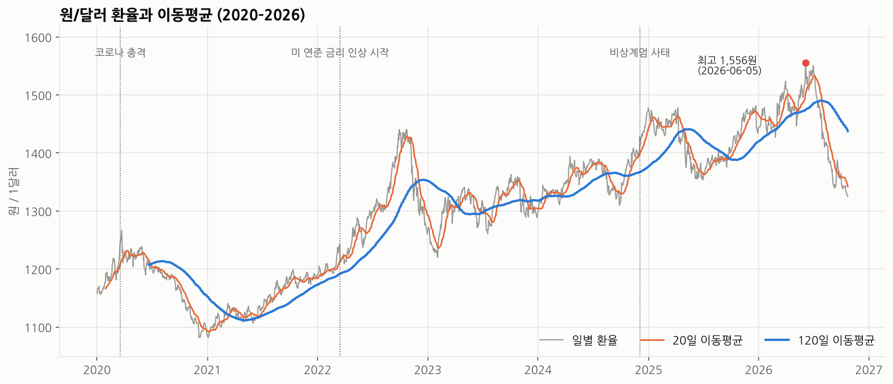
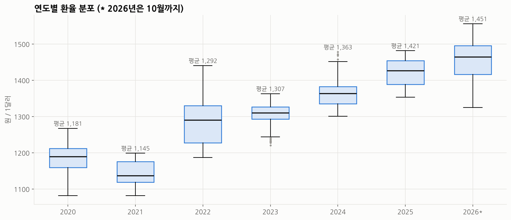
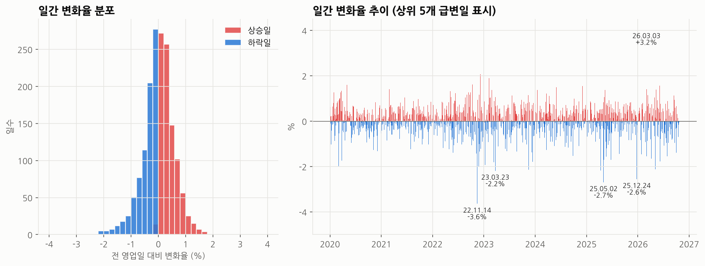
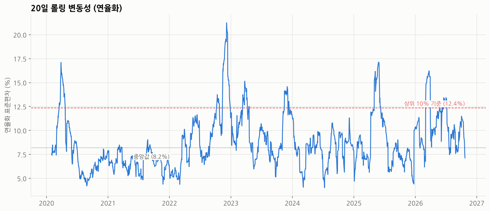
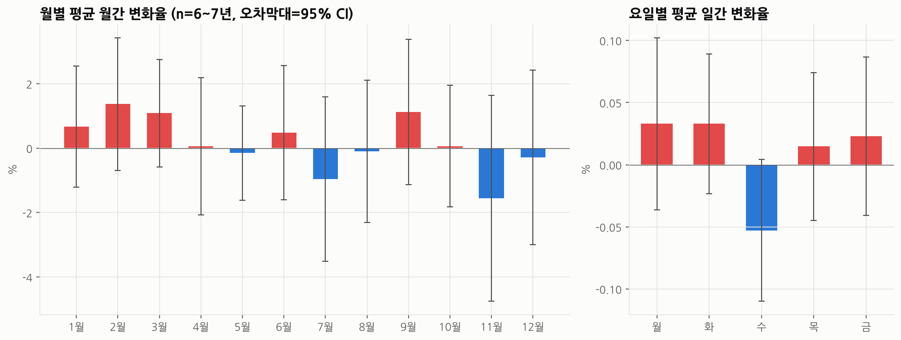
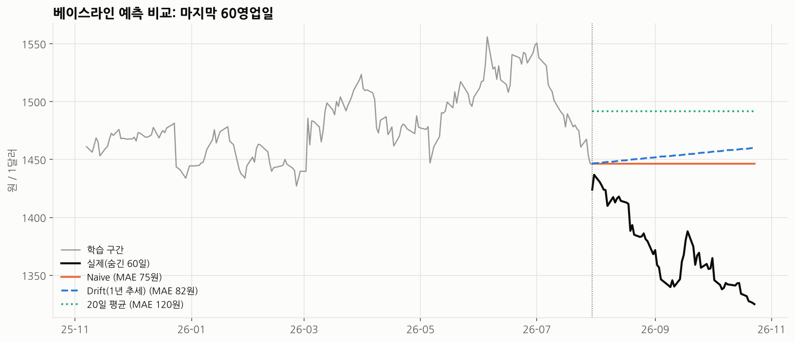

# 원/달러 환율 2020~2026 트렌드 분석 리포트

> 데이터: FRED `DEXKOUS` 일별 원/달러 환율 · 기간 2020-01-02 ~ 2026-10-23 · 1,703개 데이터 포인트
> 코드: [`analysis.ipynb`](analysis.ipynb) · 수집: [`collect_data.py`](collect_data.py) · 리포트의 모든 수치는 노트북 출력([`stats.json`](stats.json))에서 가져왔다.

---

## 1. 분석 주제 및 선정 이유

- 2020년 이후 원/달러 환율은 코로나 충격, 미국의 급격한 금리 인상, 국내 정치 이슈, 지정학적 리스크 등 굵직한 사건을 연달아 겪었다.
- 환율은 해외여행·직구·수입 물가·수출 기업 실적 등 일상과 직접 연결되는 숫자다. 뉴스에서는 "역대급 고환율"이라는 말이 반복되는데, **실제로 데이터로 보면 추세가 있었는지, 급변은 어떤 모양으로 일어나는지**를 확인하고 싶었다.

## 2. 분석 질문

| # | 질문 | 성격 | 사용한 기법 |
|---|---|---|---|
| Q1 | 2020~2026년 전체적으로 환율에 상승 추세가 있었는가? 추세는 언제 꺾였는가? | 그래프로 확인 | 이동평균(20·120일), 교차 시점, 연도별 통계 |
| Q2 | 급등·급락은 어떤 모양으로 일어나는가? 오를 때와 내릴 때가 다른가? | 그래프 + 해석 | 일간 변화율, 분포, 상위 급변일 |
| Q3 | 변동성이 특히 컸던 시기는 언제이고, 그 시기에 무슨 일이 있었는가? | 해석 필요 | 20일 롤링 표준편차(연율화) |
| Q4 | 특정 월·요일에 환율이 오르는 계절성이 있는가? | 그래프로 확인 | 월별·요일별 집계 + 95% 신뢰구간 |
| Q5 (보너스) | 단순한 방법으로 환율을 예측하면 어디서 틀리는가? | 해석 필요 | 베이스라인 예측 3종 + 롤링 백테스트 |

## 3. 데이터 설명

| 항목 | 내용 |
|---|---|
| 출처 | 미국 연방준비제도 H.10 통계 → FRED 시리즈 [`DEXKOUS`](https://fred.stlouisfed.org/series/DEXKOUS) (South Korean Won to U.S. Dollar Spot Exchange Rate) |
| 수집 경로 | FRED 데이터를 국가별로 정리한 공개 저장소 [datasets/exchange-rates](https://github.com/datasets/exchange-rates)의 `daily.csv`에서 `South Korea` 행 추출 (`collect_data.py`) |
| 기준 | **뉴욕 정오 기준** 매수 환율 (원 / 1달러). 서울 외환시장 종가와는 시차 때문에 값이 다를 수 있다 (한계점 참고) |
| 기간 | 2020-01-01 ~ 2026-10-23 (원본 1,778행) |
| 컬럼 | `date`(날짜), `usdkrw`(환율) |
| 라이선스 | Fed H.10 통계는 미국 정부 공개 자료이고, 미러 저장소는 ODC-PDDL(퍼블릭 도메인)로 배포된다. 재배포 시 출처(Board of Governors of the Federal Reserve System, FRED)를 표기한다. |

### 정제 기준

**결측치 (75개)**
- 미국 영업일 기준 데이터라 주말은 행 자체가 없고, 미국 공휴일(신정, 마틴 루터 킹 데이, 추수감사절 등)은 행은 있지만 값이 비어 있다. 결측일의 59%(44개)가 월요일인 것도 미국 '월요일 공휴일' 제도와 일치한다.
- **처리: 삭제.** 거래가 없던 날이므로 앞 값으로 채우면(ffill) '변화율 0%'인 가짜 날이 생겨 변동성이 과소평가된다. → 정제 후 **1,703개**.
- 주의: 공휴일 다음 날의 변화율은 2영업일치 변화가 합쳐진 값이다. 실제로 기간 내 최대 급락일(2022-11-14)이 이 경우였다 (인사이트 2 참고).

**이상치 (후보 4개 → 제거 0개)**
- 기준: 일간 변화율의 |z-score| > 4 를 후보로 표시하고, **다음 영업일에 80% 이상 되돌렸는지**로 '입력 오류 스파이크'와 '실제 급변'을 구분했다.
- 후보 4일(2022-11-14, 2025-05-02, 2025-12-24, 2026-03-03) 모두 되돌림이 없었고, 2026-03-03은 언론 보도로도 급등이 확인돼 **실제 시장 움직임으로 판단해 유지**했다. 환율 분석에서는 급변 자체가 분석 대상이기 때문이다.
- 값의 범위(1,081~1,556원)도 정상이라 단위 오류는 없었다.

### 집계 단위 선택 근거
- 추세·변동성은 **일 단위**: 급변이 하루 만에 일어나므로 주·월 단위로 묶으면 사라진다.
- 계절성은 **월 단위**: 일 단위는 노이즈가 커서 월별 패턴이 묻히기 때문에, 월말 값 기준 월간 변화율로 비교했다.

---

## 4. 분석 결과 및 시각화

### 4-1. 추세: 환율과 이동평균

- 20일선은 약 1개월, 120일선은 약 반년의 평균 수준을 나타낸다. 20일선이 120일선을 뚫는 시점을 '추세 전환' 신호로 보았다.
- 시작(1,157.95원) 대비 끝(1,325.06원)은 +14.4%이지만, 그 사이 최저 1,081.62원(2021-01-04)과 최고 1,555.96원(2026-06-05)을 오갔다.
- 20일선과 120일선의 교차는 6년 10개월 동안 13번 있었고, 그중 2023년에만 4번 일어났다.

### 4-2. 연도별 분포

| 연도 | 평균 | 최저 | 최고 | 범위 | 연간 변화율 |
|---|---|---|---|---|---|
| 2020 | 1,180.6 | 1,081.8 | 1,267.2 | 185.4 | -6.2% |
| 2021 | 1,144.9 | 1,081.6 | 1,198.7 | 117.1 | +9.9% |
| 2022 | 1,291.8 | 1,187.0 | 1,440.5 | 253.5 | +5.8% |
| 2023 | 1,306.8 | 1,220.3 | 1,362.9 | 142.6 | +1.6% |
| 2024 | 1,363.4 | 1,300.5 | 1,477.9 | 177.3 | +13.6% |
| 2025 | 1,421.4 | 1,353.5 | 1,481.4 | 128.0 | -1.9% |
| 2026* | 1,451.2 | 1,325.1 | 1,556.0 | 230.9 | -8.3% |

\* 2026년은 10월 23일까지

### 4-3. 일간 변화율과 급변일

| 순위 | 날짜 | 변화율 | 직전 영업일과 간격 |
|---|---|---|---|
| 1 | 2022-11-14 | -3.64% | 4일 (미국 공휴일 포함) |
| 2 | 2026-03-03 | +3.18% | 1일 |
| 3 | 2025-05-02 | -2.69% | 1일 |
| 4 | 2025-12-24 | -2.55% | 1일 |
| 5 | 2023-03-23 | -2.19% | 1일 |
| 6 | 2025-04-11 | -2.18% | 1일 |
| 7 | 2023-11-15 | -2.14% | 1일 |
| 8 | 2026-05-06 | -2.12% | 1일 |
| 9 | 2022-12-06 | +2.07% | 1일 |
| 10 | 2022-11-25 | -2.02% | 2일 |

### 4-4. 변동성

- 20영업일 일간 변화율의 표준편차에 √252를 곱해 연율화했다. 전체 중앙값은 8.2%, 상위 10% 기준선은 12.4%다.
- 상위 10%를 5영업일 이상 연속으로 넘긴 '고변동성 국면'은 8번이었다.

| 국면 | 기간 | 최고 변동성 | 구간 중 환율 변화 |
|---|---|---|---|
| ① | 2020-03-17 ~ 04-21 | 17.1% | -11.7원 |
| ② | 2022-10-11 ~ 10-24 | 13.7% | +3.8원 |
| ③ | 2022-11-14 ~ 12-27 | **21.2%** (기간 최고) | -56.4원 |
| ④ | 2023-03-13 ~ 04-07 | 15.1% | +18.6원 |
| ⑤ | 2023-11-15 ~ 12-05 | 14.6% | +11.1원 |
| ⑥ | 2025-05-02 ~ 06-09 | 17.1% | -43.9원 |
| ⑦ | 2026-03-03 ~ 03-30 | 16.2% | +33.1원 |
| ⑧ | 2026-06-18 ~ 07-06 | 13.4% | -9.7원 |

### 4-5. 계절성: 월별·요일별 패턴

- 막대는 평균, 오차막대는 95% 신뢰구간이다. 구간이 0을 포함하면 "평균이 0과 다르다고 말할 수 없다"는 뜻이다.
- **12개월 전부, 5개 요일 전부 신뢰구간이 0을 포함한다.**

---

## 5. 인사이트

### 인사이트 1. 환율의 '바닥'이 해마다 올라왔고, 2026년 하반기에 처음으로 크게 꺾였다 (Q1)

- **관찰(Fact)**
  - 연평균 환율이 2021년 1,144.9원 → 2022년 1,291.8원 → 2023년 1,306.8원 → 2024년 1,363.4원 → 2025년 1,421.4원 → 2026년 1,451.2원으로 **5년 연속 상승**했다.
  - 연중 최저값도 1,081.6원(2021) → 1,187.0원(2022) → 1,220.3원(2023) → 1,300.5원(2024) → 1,353.5원(2025)으로 매년 올라갔다. 박스플롯의 상자 자체가 계단처럼 올라간다.
  - 환율이 120일선 위에 머문 날의 비율은 2021년 81.5%, 2022년 88.0%로 상승 추세가 뚜렷했고, 2023년은 49.8%로 방향이 없었다.
  - 그런데 2026-06-05 최고점(1,555.96원) 이후 약 4개월 반 만에 1,325.06원으로 **-14.8%** 하락했고, 2026-07-30에 20일선이 120일선을 하향 돌파했다. 마지막 값은 2023년 수준까지 내려왔다.
- **원인(Why) — 가설**
  - 2022년의 급등은 미 연준의 빠른 금리 인상(2022년 3월 시작)으로 한미 금리 차가 벌어진 시기와 겹친다. 이후에도 '바닥'이 내려오지 않은 것은 금리 차가 장기간 유지되며 달러 자산 선호가 구조적으로 굳었을 가능성이 있다.
  - 2026년 6월 고점 무렵 언론은 외국인의 대규모 국내 주식 순매도(하루 7.7조 원으로 역대 최대), 미국 긴축 장기화 기대에 따른 달러 강세, 엔화 약세를 원인으로 꼽았다 ([머니투데이](https://www.mt.co.kr/article/2026063016295773163)).
  - 8월 이후의 하락에 대해서는 연준의 추가 금리 인상 기대 약화, 미국 물가·소비 지표 부진, 반도체 수출 기업의 상시적인 달러 매도가 거론됐다 ([SBS Biz](https://biz.sbs.co.kr/amp/article/20000329458)). 이 데이터만으로 어느 요인이 더 컸는지는 검증할 수 없다.
- **행동(Action)**
  - 하락이 '추세 전환'인지 '일시 조정'인지 판단하려면 120일선의 방향(현재 하락 중)이 유지되는지, 그리고 2025년 최저(1,353.5원)보다 아래에서 버티는지를 계속 지켜볼 필요가 있다.
  - 추가 분석: 한미 기준금리 차와 외국인 주식 순매수 데이터를 붙여, 환율 수준과의 상관을 기간별로 비교해 본다.

### 인사이트 2. 환율은 "계단으로 오르고 엘리베이터로 내린다" (Q2)

- **관찰(Fact)**
  - 오른 날(889일)이 내린 날(799일)보다 많지만, ±1.5% 이상 크게 움직인 37일 중 **27일이 하락**(상승은 10일)이었다.
  - 급변 상위 10일 중 **8일이 하락**이다. 분포도 왼쪽 꼬리가 더 길다(왜도 -0.49).
  - 일간 변화율의 68.7%는 ±0.5% 이내였다. 평소엔 조용하다가 드물게 크게 움직이는 구조다.
- **원인(Why) — 가설**
  - **가설 A — 하락은 '이벤트'가 만든다**: 급락일 상당수가 미국 물가·금리 발표 직후다. 2022-11-14는 미국 10월 CPI가 예상보다 낮게 나온(11/10) 직후이고, 2023-11-15도 미국 CPI 발표 다음 날이며, 2023-03-23은 FOMC 다음 날이다. 2025-04-11은 미국 관세 유예 발표 직후다. "달러가 너무 올랐다"는 긴장이 한 번에 풀릴 때 큰 하락이 나온다는 해석이 가능하다. 2025-05-02(아시아 통화 동반 강세)와 2025-12-24(외환 당국 대응)도 이벤트성으로 보이지만, 정확한 원인은 추가 확인이 필요하다.
  - **가설 B — 상승은 '누적'이 만든다**: 금리 차, 해외 투자 증가처럼 달러 수요가 매일 조금씩 쌓이는 요인은 하루 급등보다 완만한 상승으로 나타난다.
  - **반례**: 2026-03-03은 +3.18%로 급등이었다. 언론은 미국-이란 갈등 격화와 외국인의 5조 원 넘는 주식 순매도를 원인으로 보도했다 ([한국경제](https://www.hankyung.com/article/2026030365731)). 즉 지정학적 충격은 반대로 '엘리베이터 급등'을 만든다.
  - **데이터 착시 주의**: 1위 급락일(2022-11-14)은 미국 공휴일(11/11) 때문에 2영업일치 변화가 합쳐진 값이다. 하루 변화로 보면 과장되어 있다.
- **행동(Action)**
  - 환전할 때 "내일 갑자기 크게 오를 위험"보다 "갑자기 크게 내릴 가능성"이 통계적으로 더 컸다. 다만 지정학 충격은 예외였다.
  - 추가 분석: 미국 CPI·FOMC 발표일 목록을 만들어 '발표 다음 날의 변화율 분포'와 '그 외 날'을 비교하면 가설 A를 직접 검증할 수 있다.

### 인사이트 3. 고변동성 국면은 6년간 8번, 평균 3~4주 지속되고 2026년이 가장 불안정했다 (Q3)

- **관찰(Fact)**
  - 변동성 상위 10%(12.4% 초과) 국면은 8번 있었고, 길이는 10~30영업일이었다.
  - 최고치는 2022-12-06의 21.2%로 평소(중앙값 8.2%)의 2.6배였다.
  - 연평균 변동성은 2021년 6.7%로 가장 낮았고, **2026년 10.6%로 가장 높다**(10월까지).
  - 국면 8개 모두 **첫날 환율이 하루에 ±1.2% 이상 움직이며** 시작했다(하락 4번, 상승 4번). 변동성은 서서히 커지기보다 큰 하루를 계기로 갑자기 뛰었다.
- **원인(Why) — 가설**
  - 변동성은 '방향'과 별개로 '불확실성'을 보여준다. 2020년 3월(코로나), 2022년 말(미국 물가 정점 논쟁), 2026년(지정학 충격과 그 뒤의 급반락)처럼 **시장이 기존 전제를 다시 계산해야 하는 시기**에 높아진다.
  - 국면이 3~4주 지속되는 것은 큰 충격 후 시장이 새 균형을 찾는 데 시간이 걸리기 때문일 수 있다. 다만 이 기간에는 20일 롤링 창 자체가 충격일을 20일간 포함하는 계산상의 효과도 섞여 있다.
- **행동(Action)**
  - 큰 금액을 환전하거나 해외 결제를 앞두고 있다면, 변동성이 상위 10% 구간에 있을 때는 한 번에 바꾸기보다 나눠서 바꾸는 편이 가격 위험을 줄인다.
  - 추가 분석: 롤링 창을 10일·60일로 바꿔 국면의 개수와 길이가 어떻게 달라지는지 확인하면 창 길이 효과를 분리할 수 있다.

### 인사이트 4. 월별·요일별 계절성은 없다 — "3월엔 오른다"는 우연과 구분되지 않는다 (Q4)

- **관찰(Fact)**
  - 3월은 7년 중 6년(85.7%) 상승해 평균 +1.09%였고, 11월은 평균 -1.56%로 가장 낮았다. 막대만 보면 패턴이 있어 보인다.
  - 하지만 3월의 95% 신뢰구간은 ±1.66%p, 11월은 ±3.20%p로 **모두 0을 포함**한다. 12개월·5개 요일 중 0을 벗어난 것은 하나도 없다.
- **원인(Why) — 해석**
  - 월별 표본이 6~7개뿐이라 특정 연도의 사건 하나가 평균을 크게 끌고 간다. 11월 평균은 2022년(-7.56%)과 2023년(-4.52%) 두 해의 급락이 만든 것이고, 3월 평균 +1.09%도 2026년 3월(+5.81%)을 빼면 +0.30%로 줄어든다.
  - 환율은 기온·판매량처럼 달력에 묶인 수요가 아니라 금리·자본 흐름에 반응하는 가격이라서, 계절성이 약한 것이 자연스럽다.
- **행동(Action)**
  - "몇 월에 환전하면 유리하다"는 주장은 이 데이터로는 지지되지 않는다.
  - 이 결과 때문에 보너스 과제로 '시계열 분해'(계절성 분리) 대신 '베이스라인 예측'을 선택했다.

---

## 6. (보너스 B) 베이스라인 예측

마지막 60영업일(2026-07-30 ~ 10-23)을 숨기고, 그 이전 데이터만으로 세 가지 단순 예측을 했다.

| 방법 | 가정 | MAE (원) | MAPE |
|---|---|---|---|
| Naive (마지막 값 유지) | 내일 = 오늘 (랜덤워크) | **74.9** | 5.52% |
| Drift (직전 1년 추세 연장) | 최근 1년의 기울기가 계속된다 | 81.9 | 6.04% |
| 20일 평균 유지 | 최근 한 달 평균으로 돌아간다 | 120.1 | 8.82% |

한 번의 결과는 우연일 수 있어, 과거 68개 시점에서 같은 방식으로 반복(롤링 백테스트)했다.

| 방법 | 68회 평균 MAE (원) | 가장 정확했던 횟수 |
|---|---|---|
| Naive | **31.4** | 15회 |
| Drift | 31.8 | **33회** |
| 20일 평균 | 36.7 | 20회 |

- **관찰**: 마지막 60일 구간에서는 세 방법 모두 크게 빗나갔다. 실제 환율이 1,446원에서 1,325원으로 빠졌는데, 세 방법 모두 '현 수준 유지 또는 상승'을 가정했기 때문이다.
- **해석**: Drift는 이긴 횟수가 가장 많지만(33회) 평균 오차는 Naive와 비슷하다. **추세가 이어지는 동안엔 조금씩 이기고, 추세가 꺾이는 순간 크게 진다**는 뜻이다. 이번 60일이 바로 그 '꺾이는 순간'이었다.
- **가정과 한계**: 세 방법 모두 과거 가격만 보고 금리·이벤트 정보를 쓰지 않는다. 인사이트 2처럼 환율의 큰 움직임은 이벤트에서 나오므로, 가격만 보는 모델이 전환점을 맞히기는 구조적으로 어렵다. 결론적으로 **"내일 환율의 최선의 추정은 오늘 환율"이라는 랜덤워크 가설을 단순 모델로는 이기기 어렵다**는 것을 확인했다.

---

## 7. 결론 및 한계점

### 결론
1. 2021~2026년 원/달러 환율은 연평균 기준 5년 연속 올랐고 '바닥'도 매년 높아졌다. 2026년 6월 1,556원 고점 이후 약 15% 하락하며 처음으로 큰 반락이 나타났다.
2. 환율은 완만하게 오르고 급하게 내리는 비대칭을 보였다. 큰 하락은 미국 물가·금리 발표 같은 이벤트와 시기가 겹친다.
3. 변동성은 6년간 8번 급등했고 2026년이 가장 불안정했다.
4. 월·요일 계절성은 통계적으로 확인되지 않았고, 단순 예측은 추세 전환점에서 크게 틀렸다.

### 한계점
- **외부 변수 미반영**: 금리 차, 외국인 자금 흐름, 무역수지 등을 데이터에 넣지 않았다. 인사이트의 '원인'은 날짜가 겹친다는 사실에 기반한 가설이며 인과관계를 증명하지 않는다.
- **기준 시각 차이**: 뉴욕 정오 기준 값이라 서울 종가와 다르다. 예를 들어 2026-03-03의 서울 종가는 1,466.1원으로 보도됐지만([한국경제](https://www.hankyung.com/article/2026030365731)) 이 데이터는 1,485.6원이다. 서울 장 마감 이후의 움직임까지 반영되기 때문이다. 한국 사건의 당일 효과는 하루 늦게 또는 다르게 잡힐 수 있다.
- **미국 영업일 기준**: 한국은 영업일이지만 미국은 공휴일인 날이 빠지고, 그 다음 날 변화율에 2일치가 합쳐진다.
- **짧은 표본**: 월별 계절성은 월당 6~7개 표본뿐이라 결론의 힘이 약하다.
- **분석 창 선택**: 20·120일 이동평균, 20일 변동성 창, 상위 10% 기준은 관례적인 선택이며, 바꾸면 교차 횟수와 국면 수가 달라진다.

---

## 8. AI 사용 로그

| 사용 작업 | 사용 이유 | 검증 방법 |
|---|---|---|
| 주제 후보 비교 (환율, 따릉이, 기온 등) | 대안 탐색 | 데이터 구하기 쉬운지, 해석 거리가 있는지 기준으로 직접 최종 선택 |
| 데이터 수집 경로 탐색 (FRED 미러 저장소) | 시간 절감 | 원본 FRED 페이지와 시리즈명(`DEXKOUS`)·단위를 대조하고, 2026-03-03 값을 언론 보도 수치와 비교해 기준 시각 차이를 확인 |
| 전처리·분석·시각화 코드 초안 작성 | 시간 절감 | 노트북을 처음부터 다시 실행해 재현 확인. 결측 75개가 미국 공휴일인지 날짜·요일로 샘플 체크. 연도별 평균을 별도 계산과 대조 |
| 이상치 판별 기준 제안 (z-score + 되돌림 체크) | 대안 탐색 | 후보 4일을 원 데이터에서 직접 확인하고, 1개(2026-03-03)는 기사로 실제 급등임을 확인 |
| 그래프 레이아웃 수정 (라벨 겹침, 색 구분) | 품질 개선 | 저장된 png를 직접 열어 겹침과 범례 확인 |
| 급변일 원인 가설 정리 및 관련 기사 검색 | 해석 보조 | 원인 문장은 '가설'로 표기. 확인이 안 된 날짜(2025-05-02, 2025-12-24)는 '추가 확인 필요'로 남김 |
| 리포트 문장 다듬기 | 가독성 | 리포트 속 모든 수치를 `stats.json`과 대조 |

> 분석 코드와 리포트 초안은 AI(Claude)의 도움을 받아 작성했다. 본인은 노트북을 로컬 환경(Windows, Jupyter)에서 처음부터 다시 실행해 그래프와 수치가 똑같이 재현되는 것을 확인했다.

## 9. 실행 방법

[README.md](README.md) 참고.
